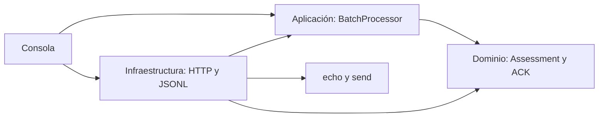

# Decisiones de arquitectura

La aplicación depende de puertos definidos en su propia capa. El dominio no conoce rutas, JSON, archivos ni credenciales. La consola compone dependencias sin un contenedor de inyección: el número de componentes no justifica añadir un framework.

## Transacción e incertidumbre

El UUID identifica un intento local. MSH-10 pertenece al mensaje clínico y se preserva; SHA-256 registra integridad de los bytes originales. La correlación exige exactamente un MSA y coincidencia de MSA-2. Los identificadores repetidos no provocan deduplicación implícita.

La auditoría se confirma en disco antes del efecto externo y después de la respuesta. No existe transacción distribuida entre el registro y el sistema de archivos. Un corte puede dejar un intento pendiente, que exige reconciliación humana. Se elige envío secuencial para limitar carga y simplificar trazabilidad de ocho documentos.

Un HTTP 200 no equivale a aceptación. Un HTTP 500 tampoco demuestra rechazo clínico: el registro pudo procesar el documento antes del fallo intermediario. Los acuses de commit no se elevan a aceptación de aplicación. No se configuran reintentos de POST ni políticas que puedan duplicar inmunizaciones.

## Seguridad y límites

Los mensajes y las respuestas se mantienen fuera de logs de consola. El informe contiene identificadores y motivos del registro que pueden incluir datos sensibles, por lo que se excluye de Git y requiere almacenamiento con acceso restringido y política de retención institucional. El diario no guarda el mensaje completo ni el ACK crudo.

Las credenciales se leen de variables de entorno, y las redirecciones HTTP están deshabilitadas. El transporte exige HTTPS fuera del simulador local y conserva verificación TLS. Los límites de tamaño y tiempo son configurables. No se hacen llamadas a endpoints fuera del echo y send configurados.

El lector admite archivos UTF-8, conserva saltos de línea y no normaliza el payload de forma silenciosa. Otros juegos de caracteres requieren una decisión explícita y pruebas adicionales. Los ERR se conservan como hallazgos; no se intenta corregir clínicamente el mensaje ni reinterpretar reglas del registro.

## Evolución prevista

El contrato REST v1 confirmado se encapsula en DTO de infraestructura y pruebas de transporte. Si aumenta el volumen, se puede sustituir JSONL por almacenamiento transaccional mediante el puerto de auditoría. Antes de añadir concurrencia o reintentos se necesita acordar idempotencia con el proveedor.

La demo demuestra la integración local y las decisiones de clasificación. No prueba la compatibilidad del contrato externo ni afirma resultados reales del registro.

## Presentación y trazabilidad

El HTML es una proyección del diario, no una fuente de resultados. El renderer recibe el resultado clasificado y códigos de motivo tipados para presentar diagnósticos internos en español. Los motivos originales y los hallazgos del registro se conservan en el detalle. La compatibilidad con diarios anteriores reconoce exclusivamente los mensajes internos conocidos; nunca reclasifica una respuesta por su texto.

El contexto de ejecución se registra antes del primer intento y distingue una simulación del servicio externo. Los estilos y el comportamiento están separados del renderer como recursos embebidos: el informe final sigue siendo un único archivo utilizable sin red.
