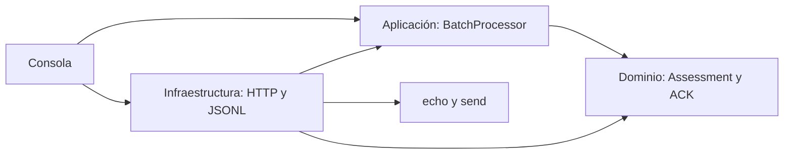

# Decisiones de arquitectura

La aplicación depende de puertos definidos en su propia capa. El dominio no conoce rutas, JSON, archivos ni credenciales. La consola compone dependencias sin un contenedor de inyección: el número de componentes no justifica añadir un framework.

## Transacción e incertidumbre

El UUID identifica un intento local. MSH-10 pertenece al mensaje clínico y se preserva; SHA-256 registra integridad de los bytes originales. La correlación exige exactamente un MSA y coincidencia de MSA-2. Los identificadores repetidos no provocan deduplicación implícita.

La auditoría se confirma en disco antes del efecto externo y después de la respuesta. No existe transacción distribuida entre el registro y el sistema de archivos. Un corte puede dejar un intento pendiente, que exige reconciliación humana. Se elige envío secuencial para limitar carga y simplificar trazabilidad de ocho documentos.

Un HTTP 200 no equivale a aceptación. Un HTTP 500 tampoco demuestra rechazo clínico: el registro pudo procesar el documento antes del fallo intermediario. Los acuses de commit no se elevan a aceptación de aplicación. No se configuran reintentos de POST ni políticas que puedan duplicar inmunizaciones.

## Seguridad y límites

Los mensajes y las respuestas se mantienen fuera de logs de consola. El informe contiene identificadores y motivos del registro que pueden incluir datos sensibles, por lo que se excluye de Git y requiere almacenamiento con acceso restringido y política de retención institucional. El diario no guarda el mensaje completo ni el ACK crudo.

Las credenciales se leen de variables de entorno, y las redirecciones HTTP están deshabilitadas. El transporte exige HTTPS fuera del simulador local y conserva verificación TLS. Los límites de tamaño y tiempo son configurables. No se hacen llamadas a endpoints fuera del echo y send configurados.

El lector admite archivos UTF-8, conserva saltos de línea y no normaliza el payload de forma silenciosa. Otros juegos de caracteres requieren una decisión explícita y pruebas adicionales. Los ERR se conservan como hallazgos; no se intenta corregir clínicamente el mensaje ni reinterpretar reglas del registro.

## Evolución prevista

El contrato REST v1 confirmado se encapsula en DTO de infraestructura y pruebas de transporte. Si aumenta el volumen, se puede sustituir JSONL por almacenamiento transaccional mediante el puerto de auditoría. Antes de añadir concurrencia o reintentos se necesita acordar idempotencia con el proveedor.

La demo demuestra la integración local y las decisiones de clasificación. No prueba la compatibilidad del contrato externo ni afirma resultados reales del registro.

## Presentación y trazabilidad

El HTML es una proyección del diario, no una fuente de resultados. El renderer recibe el resultado clasificado y códigos de motivo tipados para presentar diagnósticos internos en español. Los motivos originales y los hallazgos del registro se conservan en el detalle. La compatibilidad con diarios anteriores reconoce exclusivamente los mensajes internos conocidos; nunca reclasifica una respuesta por su texto.

El contexto de ejecución se registra antes del primer intento y distingue una simulación del servicio externo. Los estilos y el comportamiento están separados del renderer como recursos embebidos: el informe final sigue siendo un único archivo utilizable sin red.

## Identidades y fallos de entrega

HTTP Basic utiliza `ApiCredentials`. La solicitud de transferencia utiliza `RegistryCredentials`, que compone `ClinicIdentity` y `TransferCredentials`. El cliente HTTP recibe la identidad de API explícitamente desde la consola; el adaptador no consulta variables de entorno para descubrirla. El OID de la clínica en el sobre JSON y los identificadores de establecimiento del HL7 cumplen funciones distintas y se preservan por separado.

El UUID de intento, MSH-10, el identificador de la API y el hash del archivo tampoco se intercambian. Uno identifica la ejecución local, otro permite correlacionar el ACK, otro facilita consultar al proveedor y el último comprueba integridad. Compartir MSH-10 o contenido no implica que dos intentos sean la misma transacción.

`DeliveryException` define el fallo esperado del puerto de envío. Infraestructura traduce timeout, problemas de conexión e interrupciones de lectura; la aplicación los registra como incertidumbre. La cancelación del usuario sigue su propio camino. Un defecto de programación no se convierte silenciosamente en un resultado del registro.

## Capacidad y diagnóstico

La entrada se limita por cantidad de archivos, tamaño individual y suma de bytes. Se verifica antes de enviar y durante la lectura para detectar crecimiento de archivos. El lote permanece en memoria dentro de esos límites; no se presenta como un procesamiento de volumen ilimitado. El presupuesto de entrada no equivale a un límite estricto de memoria total: las cadenas, las respuestas y el HTML también consumen memoria.

Cada solicitud tiene un único plazo compartido por envío y lectura. Los cuerpos se leen hasta el límite configurado. La evidencia de respuesta conserva tamaños y huellas, el tipo declarado y una descripción de su forma aparente. Esa forma no determina la clasificación: la decisión sigue perteneciendo al intérprete de ACK. Los errores JSON conservan solamente un nombre de campo conocido, no fragmentos del contenido recibido.

Los metadatos nuevos no recuperan cuerpos descartados en ejecuciones anteriores ni reemplazan la consulta al operador cuando el resultado es incierto. También requieren el tratamiento restringido de los demás identificadores de auditoría.
