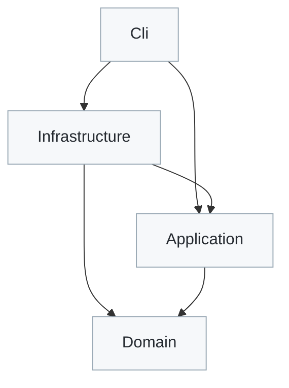
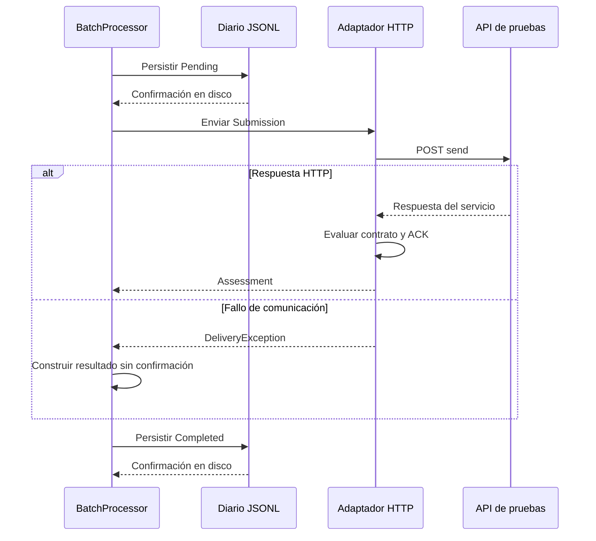

# Arquitectura

La solución separa la interpretación de respuestas, la coordinación del lote y el acceso a servicios y archivos. La consola crea los componentes y conecta sus dependencias.

## Dependencias entre proyectos

Cada flecha representa una referencia de proyecto: el origen depende del destino.

| Proyecto | Responsabilidad | Componentes principales |
| --- | --- | --- |
| `Domain` | Interpretar ACK y representar resultados | `AcknowledgmentInterpreter`, `Assessment`, `Receipt` |
| `Application` | Coordinar intentos y definir sus contratos | `BatchProcessor`, `IRegistryGateway`, `ITransactionJournal` |
| `Infrastructure` | Implementar transporte, entrada, auditoría e informes | `HttpRegistryGateway`, `InputReader`, `JsonJournal`, `HtmlReport` |
| `Cli` | Leer configuración y componer la ejecución | `Program` |

Los puertos de envío y auditoría pertenecen a `Application`. Infraestructura los implementa; el caso de uso trabaja contra esas interfaces. El dominio se mantiene independiente de HTTP, JSON y almacenamiento.

## Recorrido de un envío

La consola carga la configuración y las credenciales, comprueba `echo` y lee el lote. Por cada archivo se ejecuta esta secuencia:

El ACK se interpreta en `AcknowledgmentInterpreter`, invocado por el adaptador. El resultado vuelve al caso de uso y se registra antes de continuar con el siguiente archivo. Al finalizar, la consola genera el informe HTML. También puede regenerarlo a partir del diario, sin nuevas llamadas al servicio.

## Identidades y correlación

Cada identificador tiene una función propia:

| Dato | Función | Tratamiento |
| --- | --- | --- |
| Credenciales de API | Autenticar la conexión HTTP Basic | `ApiCredentials`, recibidas explícitamente por la fábrica del cliente |
| Credenciales de transferencia | Autenticar las operaciones del registro | `TransferCredentials`, incluidas en el cuerpo del contrato |
| OID de clínica | Identificar la clínica de la solicitud | `ClinicIdentity`; no reemplaza los establecimientos dentro del HL7 |
| UUID del intento | Identificar una ejecución local | Se conserva entre `Pending` y `Completed` |
| MSH-10 | Correlacionar el mensaje con el ACK | Debe coincidir con MSA-2 |
| `messageId` de la API | Facilitar el seguimiento con el proveedor | Se registra como `ServiceMessageId` |
| SHA-256 del archivo | Comprobar la integridad de la entrada | Se calcula sobre los bytes originales |

Los ocho archivos originales comparten MSH-10. Esa coincidencia no fusiona transacciones: cada archivo conserva su intento y su respuesta. Tampoco se utiliza el hash como una regla de deduplicación clínica.

## Decisiones de operación

| Decisión | Motivo | Comportamiento verificable |
| --- | --- | --- |
| Envíos secuenciales | Mantener el orden y controlar la carga de ocho documentos | Un intento termina antes de comenzar el siguiente |
| Auditoría previa al envío | Conservar evidencia antes del efecto externo | Si falla `Pending`, no se llama al registro |
| Sin reintentos automáticos | Evitar duplicaciones cuando la entrega es incierta | Un timeout no dispara otro POST |
| Fallos de entrega tipados | Mantener HTTP fuera del caso de uso | El adaptador traduce errores esperados a `DeliveryException` |
| Cancelación diferenciada | Separar una decisión del usuario de un vencimiento del plazo | Un intento activo queda sin confirmación; los siguientes no comienzan |
| Límites de entrada y respuesta | Acotar recursos antes de aceptar un lote | Se comprueban cantidad y bytes; un único plazo cubre envío y lectura |

Un error HTTP no determina un rechazo clínico. Un acuse de commit tampoco demuestra aceptación de aplicación. La clasificación exige interpretar la respuesta y verificar su correlación.

No existe una transacción distribuida entre el servicio y el archivo de auditoría. Un corte puede dejar un `Pending` sin cierre. Ese intento necesita reconciliación; la solución no garantiza entrega exactamente una vez. Los errores de persistencia y los defectos inesperados detienen la ejecución.

## Informes y diagnóstico

El diario conserva los eventos de cada intento. El HTML presenta sus resultados con estados y diagnósticos internos en español; los mensajes originales del registro permanecen disponibles en el detalle. El renderer no clasifica respuestas ni cambia resultados.

La evidencia nueva incluye estado HTTP, tipo de contenido, tamaño, huellas y forma aparente de `result`. La forma sirve para diagnóstico y no reemplaza la interpretación del ACK. Los cuerpos completos no se almacenan. Los informes pueden contener información sensible y se mantienen fuera de Git, con acceso restringido.

El contexto del lote identifica una simulación y la zona horaria del informe. Un diario anterior sin ese contexto se muestra con origen no registrado. Los estilos y el comportamiento son recursos embebidos: el HTML funciona sin servidor ni conexiones externas.

## Alcance y evolución

El lote se mantiene en memoria y tiene límites configurables. El presupuesto de entrada no representa el consumo total del proceso: las cadenas, respuestas e informes también ocupan memoria. El lector acepta UTF-8 e implementa el subconjunto de ACK necesario para esta integración.

Para un volumen sostenido, los cambios siguientes serían lectura por flujo y almacenamiento transaccional detrás del puerto de auditoría. Antes de incorporar concurrencia o reintentos, se necesita acordar idempotencia y reconciliación con el proveedor.

Los parámetros y procedimientos están en [Operación](operations.md). Las comprobaciones ejecutadas y sus límites están en [Validación](validation.md).
